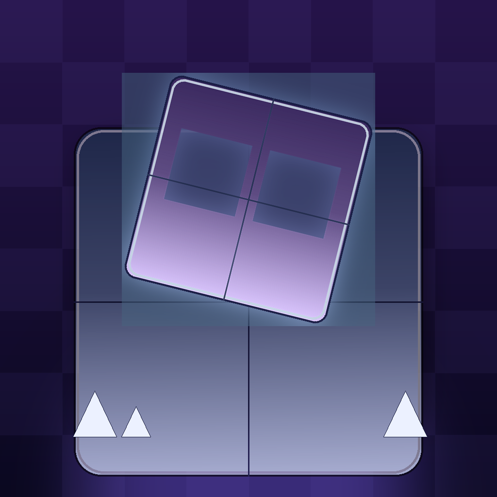

# Point of No Return

Аркада в стиле **Geometry Dash**, написанная на чистом **C11** с **SDL3**.
Один уровень — первый — называется **Point of No Return**.

* кубик (игрок) — спрайт `Cube1.png` (лежит в `assets/textures/cube.png`)
* блоки (платформы) — спрайт `Blocks 1.png` (лежит в `assets/textures/blocks.png`)
* уровень — текстовый файл `assets/levels/point_of_no_return.lvl`
  (`. ` пусто, `1` блок, `2` шип), см. [docs/LEVEL_FORMAT.md](docs/LEVEL_FORMAT.md)
* шип — свой спрайт: положите `spike.png` (или `Spike1.png`) в
  `assets/textures/`, и он подхватится автоматически; пока файла нет,
  шип рисуется кодом
* прогресс-бар, взрывы частиц, звуки — рисуются и синтезируются кодом,
  никаких других файлов игре не нужно



## Как играть

| Действие | Клавиатура / мышь | Телефон |
|---|---|---|
| Прыжок | `Space` / `↑` / `W` / ЛКМ (или удержание) | тап по экрану (можно держать) |
| Пауза | `Esc` | потеря фокуса / `Esc` |
| Заново (с начала) | `R` | — |
| Демо-режим (автопилот проходит уровень) | `F1` | — |
| Скриншот в `screenshot.bmp` | `F2` | — |
| Выход | закрыть окно | кнопка «назад» |

Кубик бежит сам, от игрока зависит только момент прыжка. Шипы и стены убивают —
уровень начинается заново, счётчик попыток растёт (как в GD).
Текущий уровень — 625 × 6 клеток (≈64 секунды идеального прохождения),
автопилот проходит его за 86 прыжков.

## Сборка для компьютера (Linux / macOS / Windows)

Нужны: компилятор с поддержкой C11, CMake ≥ 3.16, Ninja или Make,
и SDL3 (если SDL3 не установлен — CMake сам скачает и соберёт его из GitHub).

```bash
cmake -S . -B build -DCMAKE_BUILD_TYPE=Release
cmake --build build
./build/point_of_no_return
```

Если SDL3 уже установлен в нестандартное место:
`cmake -S . -B build -DCMAKE_PREFIX_PATH=/путь/к/sdl3`

Проверка, что уровень реально проходим (автопилот прогоняет уровень целиком):

```bash
ctest --test-dir build --output-on-failure
# или вручную:
./build/point_of_no_return --selftest
```

Полезные ключи: `--selftest`, `--autoplay`, `--screenshot file.bmp --shot-time 5200`,
`--manual` (не включать автопилот при скриншоте), `--size W H`, `--help`.

## Сборка APK (Android)

Нужны: JDK 17, Android SDK (platform 35, build-tools 35), NDK `27.2.12479018`.

```bash
export ANDROID_HOME=$HOME/Android/Sdk         # путь к Android SDK
scripts/build_apk.sh                          # скачает SDL3 и соберёт APK
# готовый файл: android/app/build/outputs/apk/debug/app-debug.apk
adb install -r android/app/build/outputs/apk/debug/app-debug.apk
```

Либо вручную:

```bash
scripts/fetch_sdl.sh                 # клонирует SDL3 в android/app/jni/SDL
cd android && ./gradlew assembleDebug
```

Готовый APK также собирается в GitHub Actions
(`.github/workflows/build.yml`, артефакт `point-of-no-return-apk`) — там же
собирается и проверяется десктопная версия.

Приложение: `com.ehekufa.pointofnoreturn`, ландшафтная ориентация, minSdk 21,
ABI `arm64-v8a` и `armeabi-v7a`, иконка — `docs/icon.png`
(перерисовывается скриптом `scripts/make_icons.py`).

## Структура проекта

```
assets/levels/    point_of_no_return.lvl — уровень в текстовом формате
src/gd.h          общие константы, структуры и прототипы
src/main.c        окно, события, режимы запуска (игра, селфтест, скриншот)
src/game.c        игровой цикл, частицы, весь рендер (фон, блоки, шипы, UI)
src/level.c       загрузка уровней .lvl (сетка: 1 клетка = 1 блок = 48 px)
src/physics.c     бег, прыжок, коллизии AABB, смерть/финиш
src/bot.c         автопилот: поиск последовательности прыжков + проверка уровня
src/audio.c       синтез звуков (прыжок, смерть, победа) прямо в SDL-аудиопоток
src/font.c        встроенный шрифт 5×7 (никаких файлов шрифтов)
src/assets.c      загрузка PNG через stb_image и SDL3 (десктоп и assets APK)
assets/textures/  cube.png (Cube1.png), blocks.png (Blocks 1.png)
android/          Android-проект SDL3 + Gradle
scripts/          fetch_sdl.sh, build_apk.sh, make_icons.py
```

### Как менять уровень

Уровень — обычный текст, один символ = одна клетка:

```
.   пусто
1   блок
2   шип
```

Первая строка сетки — верхний ряд, последняя стоит на земле; финиш — правый
край. Директивы `!name` и `!spawn` задают название и столбец появления.
Подробное описание — [docs/LEVEL_FORMAT.md](docs/LEVEL_FORMAT.md).

Запуск со своим уровнем и его проверка:

```bash
./build/point_of_no_return --level assets/levels/my_level.lvl
./build/point_of_no_return --selftest --level assets/levels/my_level.lvl
```

`--selftest` ищет последовательность прыжков автопилотом, прогоняет её через
настоящую физику и печатает `SELFTEST OK`, если уровень реально проходим.

### Свой спрайт шипа

Положите PNG в `assets/textures/` с именем `spike.png` (или `spike1.png`,
`Spike1.png`, `spikes.png`) — игра подхватит его автоматически и будет
рисовать шипы этим спрайтом (растягивая на клетку). Если файла нет, шип
рисуется кодом.

## Лицензия

MIT, см. [LICENSE](LICENSE).

Используются: [SDL3](https://github.com/libsdl-org/SDL) (zlib) и
[stb_image](https://github.com/nothings/stb) (public domain / MIT).
